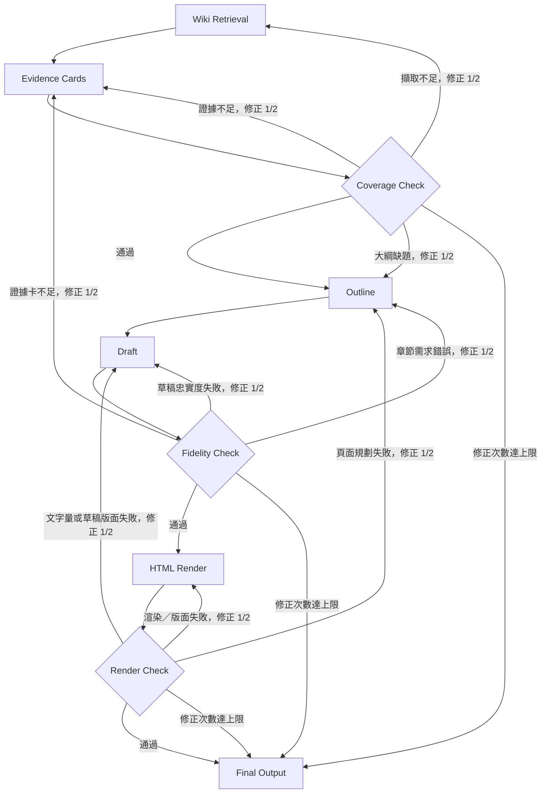

# AI Agent Workflow Graph

主題：Game AI：遊戲中的 NPC 如何思考與行動？

本文件只描述未來 HTML 投影片製作流程，不執行流程，也不包含投影片內容。

## 1. Workflow Mermaid Graph



上圖中的失敗分支不代表無限修正：

- Coverage Check 最多回到 Outline 2 次。
- Fidelity Check 最多回到 Draft 2 次。
- Render Check 最多回到 HTML Render 2 次。
- 任一檢查達到上限後，先形成明確的「未通過／人工確認」結果，不再繼續自動修正。
- 若修正不只涉及單一節點，例如 Coverage 缺少 A* 前置概念而 Outline 已明確缺頁，回到 Outline；若缺少 Wiki 擷取資料，回到 Wiki Retrieval。

## 2. 節點規格

### 2.1 Wiki Retrieval

**責任**

- 讀取 [AGENTS.md](/Users/chung/Documents/vscode/Game_AI_LLM_Wiki/AGENTS.md)、[wiki_articles/](/Users/chung/Documents/vscode/Game_AI_LLM_Wiki/wiki_articles) 及需要的來源紀錄。
- 擷取與投影片主題直接相關的章節。
- 紀錄每段知識來自哪個 Wiki 文章及對應來源。

**Input**

- 執行參數：投影片主題、讀者、預期簡報密度。
- Wiki 文章。
- 五份正式來源的來源紀錄。
- `sources/` 中的原始資料完整正文。

**Output**

- 擷取片段清單。
- 來源與 Wiki 章節對照表。
- 缺漏或不可追溯內容清單。

**允許讀取**

- `AGENTS.md`
- `wiki_articles/**/*.md`
- `sources/**/*-source.md`
- 正式原始來源 HTML／PDF 的完整正文或已確認可讀取副本

**允許修改或建立**

- 不修改 Wiki、來源或規範。
- 可在當次執行目錄建立：
  - `retrieval.json`
  - `retrieval.md`

**檢查標準**

- 擷取內容確實存在於 Wiki 或原始來源。
- 不把來源資源頁當成完整論文正文。
- 不讀取或補寫未收錄來源的事實。
- 每段擷取都能連到至少一個來源。

---

### 2.2 Evidence Cards

**責任**

- 將 Wiki 擷取片段整理成可引用的 Evidence Card。
- 每張證據卡只包含一個知識點、來源、用途及限制。
- 區分已驗證事實、教學範例與推測建議。

**Input**

- Wiki Retrieval 的擷取片段清單。
- Wiki 文章與來源紀錄。

**Output**

- Evidence Card JSON 或 YAML。
- Evidence Card Markdown 摘要。
- 未支援主張清單。

**允許讀取**

- Wiki Retrieval 的輸出。
- 對應 Wiki 文章。
- 對應來源紀錄與完整原始資料。

**允許修改或建立**

- 不修改原始資料或 Wiki。
- 可在當次執行目錄建立：
  - `evidence_cards.json`
  - `evidence_cards.md`

**檢查標準**

- 卡片有標題、主張、來源 URL、原始檔位置及章節或位置。
- 每個公式、技術定義或行為描述可追溯。
- 教學例子明確標示為例子，不偽稱直接來自原始來源。
- 不包含無來源事實或虛構引用。

---

### 2.3 Coverage Check

**責任**

- 檢查投影片是否涵蓋主題必要知識。
- 確認初學者有足夠的前置概念、核心概念與章節順序。

**Input**

- Evidence Cards。
- AGENTS.md 的主題範圍與讀者規範。
- 當前是否已有 Outline；若是，亦檢查 Outline。

**Output**

- Coverage Matrix。
- 必要主題已涵蓋／缺少／來源不足清單。
- 通過或失敗結論。

**允許讀取**

- Evidence Cards。
- AGENTS.md。
- 現有五篇主題 Wiki。
- 當前執行目錄中的 Outline。

**允許修改或建立**

- 不修改 Wiki 或來源。
- 可建立或更新：
  - `coverage_check.json`
  - `coverage_check.md`

**檢查標準**

最少檢查：

- Sense／Think／Act 或 Game AI 基礎脈絡。
- FSM。
- Behavior Tree。
- A* 與尋路。
- Grids、Graph、Node、Edge 與障礙物表示。
- Steering Behaviors。
- 各概念前後順序對初學者是否合理。
- 每個必要主題是否有至少一張 Evidence Card。

**失敗路由**

- 若缺少或順序錯誤是大綱問題：回到 Outline。
- 若是知識卡片遺漏或來源不足：回到 Evidence Cards。
- 若原始擷取片段不足：回到 Wiki Retrieval。
- 回到同一階段最多修正 2 次；兩次後仍失敗則進入 Final Output 的人工確認狀態。

---

### 2.4 Outline

**責任**

- 建立投影片章節順序與每張投影片的內容目的。
- 平衡初學者理解深度與簡報張數，不預設固定張數。

**Input**

- 通過或可修正的 Evidence Cards。
- Coverage Check 結果。
- AGENTS.md 的簡報密度與語言規範。

**Output**

- 投影片大綱。
- 每張投影片的證據卡索引。
- 每張投影片的預期學習目的。

**允許讀取**

- Evidence Cards。
- Coverage Check。
- AGENTS.md。
- Wiki 文章。

**允許修改或建立**

- 不修改 Wiki 或來源。
- 可建立或更新：
  - `outline.md`
  - `outline.json`
- 不建立或修改 `slides/` 下的正式投影片檔案。

**檢查標準**

- 每張投影片只聚焦一個核心概念。
- 有清楚的章節引導與前後依賴。
- 每張投影片至少連到一張 Evidence Card，除非是純標題或過場頁。
- 不預設固定張數，依主題難度彈性安排。
- 繁體中文、保留英文術語。

**失敗回到位置**

- Outline 通常只從 Coverage Check 接受修正。
- 若 Outline 顯示證據不足或來源無法支持，回到 Evidence Cards。

---

### 2.5 Draft

**責任**

- 根據 Outline 和 Evidence Cards 撰寫投影片文字。
- 整理標題、要點、簡短說明、公式、示意圖描述與來源註記。

**Input**

- Outline。
- Evidence Cards。
- Fidelity Check 的失敗清單與修正要求。

**Output**

- 投影片草稿資料。
- 投影片內引用映射。
- 未解決的事實或版面問題清單。

**允許讀取**

- Outline。
- Evidence Cards。
- AGENTS.md。
- Wiki 文章與原始來源的唯讀核對內容。

**允許修改或建立**

- 不修改 Wiki、來源或 AGENTS.md。
- 可建立或更新：
  - `draft.json`
  - `draft.md`
- 草稿不直接寫入最終 `slides/`，除非該資料經 Fidelity Check 通過。

**檜查標準**

- 每句事實性陳述可追溯到 Evidence Card。
- 不加入未經來源支持的新公式、實作細節或比較結論。
- 初學者可理解，術語中英文並列。
- 每張投影片文字量控制在可讀範圍。
- 不在草稿階段聲稱實際瀏覽版面已驗證。

**失敗回到位置**

- Fidelity Check 失敗時回到 Draft。
- 若為單一事實來源不足，先回到 Evidence Cards，再重寫 Draft。
- 若事實來源存在但大綱順序錯誤，回到 Outline。

---

### 2.6 Fidelity Check

**責任**

- 驗證投影片草稿是否忠於 Wiki 與原始來源。
- 核對引用標題、作者、URL、頁內章節及來源用途。
- 找出擴寫、改寫過度或無法追溯的主張。

**Input**

- Draft。
- Outline。
- Evidence Cards。
- 原始來源與 Wiki。

**Output**

- Fidelity Report。
- 通過或失敗結論。
- 每一項主張的來源核對結果。
- 修正清單及嚴重度。

**允許讀取**

- 所有投影片草稿與 Evidence Cards。
- Wiki、來源紀錄與完整原始來源。
- AGENTS.md。

**允許修改或建立**

- 不修改 Wiki、來源或草稿原文。
- 可建立或更新：
  - `fidelity_check.json`
  - `fidelity_check.md`

**檢查標準**

- 事實性內容在 Evidence Card 的來源章節可找到。
- 無虛構版本、作者、API、數字或比喻來源。
- 引用連結與來源紀錄一致。
- 教學範例已標示為例子。
- 標題、術語與 Wiki 的繁中名稱一致。
- 無來源不支持的「效能比較」、「必然最短」或「Unity API 已測試」等主張。

**失敗路由**

- 草稿誤讀或改寫錯誤：回到 Draft。
- 草稿引用了一張無來源或來源不足的證據卡：回到 Evidence Cards。
- 大綱要求了不存在於目前知識庫的章節：回到 Outline。
- 最大修正次數為 2 次；之後仍失敗進入人工確認。

---

### 2.7 HTML Render

**責任**

- 將通過 Fidelity Check 的 Draft 轉成可瀏覽的 HTML 投影片。
- 套用繁體中文、鍵盤導覽、基本投影片版面與來源頁尾。

**Input**

- 通過 Fidelity Check 的 Draft。
- AGENTS.md 的簡報需求。
- Render Check 指定的版面修正。

**Output**

- HTML 投影片檔案。
- HTML 資源與設定檔。
- Render Manifest。

**允許讀取**

- 通過的 Draft。
- Evidence Cards。
- AGENTS.md。

**允許修改或建立**

- 只允許在 `slides/` 建立或更新本次投影片成果。
- 可建立執行紀錄副本於：
  - `workflow/runs/<run_id>/render/`
- 不修改 Wiki、來源、AGENTS.md 或 workflow 設計。

**檢查標準**

- 使用通過 Fidelity Check 的文字，不擅自補寫事實。
- 有標題頁、章節內容與參考資料頁。
- 支援鍵盤操作與合理螢幕縮放。
- HTML 可載入，內部資源與連結路徑有效。

**失敗回到位置**

- 渲染錯誤或文字溢出：回到 HTML Render。
- 若問題源自草稿版面過多文字或不合理語句：回到 Draft。
- 若失敗來自整體章節組織或頁數估計：回到 Outline。
- Render 循環最多修正 2 次。

---

### 2.8 Render Check

**責任**

- 檢查頁數、排版、文字溢出、圖片或圖表載入及瀏覽效果。
- 檢查投影片在桌面與常見縮放比例下是否可讀。

**Input**

- HTML Render 的成果。
- Draft 原始文字。
- Render Manifest。

**Output**

- 頁面檢查清單。
- 文字溢出、頁面空白、資源失效或失去可讀性報告。
- 通過或失敗結論。

**允許讀取**

- `slides/` 的本次成果。
- Render Manifest。
- Draft。
- 瀏覽器可取得的資產。

**允許修改或建立**

- 不直接修改投影片。
- 可建立：
  - `render_check.json`
  - `render_check.md`
  - 截圖或瀏覽器檢查紀錄於當次執行目錄

**檢查標準**

- 頁數與 Outline 相符或差異已合理記錄。
- 無文字溢出版面。
- 無被裁切、重疊或過小文字。
- 圖片、圖表與內部連結可載入。
- 鍵盤導覽與全螢幕模式可操作。
- 手機或縮放檔案不造成關鍵文字不可讀。

**失敗路由**

- 單純 CSS、版面或資源路徑問題：回到 HTML Render。
- 草稿文字量或順序不適合版面：回到 Draft。
- 頁面規劃或章節過度集中：回到 Outline。
- 最多修正 2 次。

---

### 2.9 Final Output

**責任**

- 彙整最終 HTML 投影片、執行紀錄與未通過警告。
- 若所有檢查通過，標記為可交付。
- 若達修正上限，標記為需要人工確認，不宣稱成功。

**Input**

- Fidelity Check 結果。
- Render Check 結果。
- 最終 HTML 投影片。
- 所有執行紀錄。

**Output**

- 最終成果清單。
- 執行摘要。
- 已知限制與人工確認項目。

**允許讀取**

- 當次執行目錄。
- `slides/` 的最終成果。

**允許修改或建立**

- 可建立或更新：
  - `workflow/runs/<run_id>/final_output.md`
  - `workflow/runs/<run_id>/manifest.json`
- 可更新 `slides/` 的交付清單，但不可將失敗成果偽裝為通過。
- 不修改 Wiki、來源或 AGENTS.md。

**檢查標準**

- 所有必要檔案存在且可開啟。
- Fidelity Check 與 Render Check 有明確通過或人工確認狀態。
- 來源引用清單完整。
- 未通過項目已列入警告，不得隱藏。

## 3. 修正循環與停止規則

設計以兩層修正為上限：

| 失敗檢查 | 回退節點 | 第一次修正 | 第二次修正 | 第二次後仍失敗 |
|---|---|---|---|---|
| Coverage | Outline；若證據不足則 Evidence Cards；若擷取不足則 Wiki Retrieval | 重新修正後重跑 Coverage | 再修正一次後重跑 Coverage | 進入 Final Output 的人工確認 |
| Fidelity | Draft；若來源卡不足則 Evidence Cards；若章節需求錯誤則 Outline | 重寫並重跑 Fidelity | 再修正一次並重跑 Fidelity | 進入 Final Output 的人工確認 |
| Render | HTML Render；若文字不適合版面則 Draft；若章節規劃錯誤則 Outline | 重渲染並重跑 Render Check | 再修正一次並重跑 Render Check | 進入 Final Output 的人工確認 |

全域保障：

- 任何節點最多執行一次「有效修正」後仍可以進入第二次修正。
- 同一失敗原因不得重複執行超過兩次。
- 不允許自動重跑整個 Workflow 來繞過失敗。
- 最終檔案只能來自通過 Fidelity Check 和 Render Check 的成功分支；人工確認分支不得標記為完全通過。

## 4. 執行結果與檢查紀錄保存

建議採用執行目錄：

```text
workflow/
  workflow_design.md
  runs/
    <run_id>/
      retrieval.json
      retrieval.md
      evidence_cards.json
      evidence_cards.md
      coverage_check.json
      coverage_check.md
      outline.md
      outline.json
      draft.md
      draft.json
      fidelity_check.json
      fidelity_check.md
      render_manifest.json
      render_check.json
      render_check.md
      final_output.md
      manifest.json
      screenshots/
      render/
```

每次執行至少保存：

- 唯一 `run_id`、開始與結束時間、主題、讀者及簡報需求。
- 每個節點的輸入與輸出版本。
- 每次檢查的通過／失敗、失敗原因及修正次數。
- 回退來源節點與回退原因。
- Evidence Card 與投影片原文之對應關係。
- 最終成果檔案清單與雜湊。

建議的 `manifest.json` 最小欄位：

```json
{
  "run_id": "example-run-id",
  "topic": "Game AI：遊戲中的 NPC 如何思考與行動？",
  "status": "passed | needs-human-review",
  "node_attempts": {},
  "coverage_check": {},
  "fidelity_check": {},
  "render_check": {},
  "artifacts": [],
  "failures": []
}
```

所有檢查紀錄均應保留原始輸出，不覆寫上一輪失敗紀錄。可用：

```text
coverage_check_attempt_01.json
fidelity_check_attempt_01.json
render_check_attempt_01.json
```

的命名方式保存每次嘗試。

## 5. 檔案權限總結

| 節點 | 可讀取 | 可建立或修改 |
|---|---|---|
| Wiki Retrieval | AGENTS.md、Wiki、來源紀錄、原始來源完整正文 | 當次執行目錄的 retrieval 檔案 |
| Evidence Cards | Wiki Retrieval 輸出、Wiki、來源紀錄、原始來源 | 當次執行目錄的 evidence cards 檔案 |
| Coverage Check | Evidence Cards、AGENTS.md、Wiki、大綱 | 當次執行目錄的 coverage 檔案 |
| Outline | Evidence Cards、Coverage Check、AGENTS.md、Wiki | 當次執行目錄的 outline 檔案 |
| Draft | Outline、Evidence Cards、Wiki、來源、Fidelity Check | 當次執行目錄的 draft 檔案 |
| Fidelity Check | Draft、Outline、Evidence Cards、Wiki、來源、AGENTS.md | 當次執行目錄的 fidelity 檔案 |
| HTML Render | Draft、Evidence Cards、AGENTS.md | `slides/` 成果及當次執行目錄 render 資料 |
| Render Check | 最終 HTML、Draft、Manifest、瀏覽器資產 | 當次執行目錄的 render check 與截圖，不直接改投影片 |
| Final Output | 執行目錄、最終 HTML | 最終 manifest、summary 與 `slides/`交付清單 |

全流程不得修改既有 Wiki 文章、正式來源或來源紀錄。
